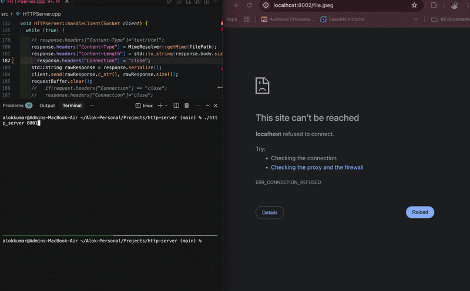

# HTTP Server — Project Documentation

A learning-oriented **C++ HTTP/1.1 static file server** built from scratch using POSIX sockets, with modular design, concurrency via a thread pool, and structured logging.

---

## 1. Project Overview

### DEMO



This project implements a minimal but functional HTTP server that:

- Listens on a TCP port (default **8001**)
- Accepts incoming client connections
- Parses HTTP/1.1 GET requests
- Serves static files from the `public/` directory
- Streams file bodies with `Transfer-Encoding: chunked` (404 responses use `Content-Length`)
- Keeps HTTP/1.1 connections open unless the client sends `Connection: close`
- Watches the listening socket and every client with a **kqueue** event loop on one thread
- Stops accepting new connections on Ctrl+C and closes the open client sockets
- Logs events and requests with timestamps, levels, status, size, and latency

It was evolved from a single-file prototype into a multi-module C++17 codebase, demonstrating networking, HTTP basics, RAII, and concurrent programming.

### Recent improvements

- **Keep-alive** — one worker serves repeated requests on the same socket and preserves bytes already read past the current request
- **Chunked responses** — file bodies are read and sent in fixed-size buffers with a terminating `0` chunk
- **Full writes** — `Socket::send()` writes what the kernel accepts. A full buffer returns a short count instead of waiting
- **Graceful shutdown** — SIGINT sets a flag and `shutdown()` wakes the kqueue wait
- **kqueue** — non-blocking `accept` and `read`, and `EVFILT_WRITE` while a response is unfinished. Idle keep-alive connections stay registered and do not occupy a thread. A ninth request returned in 0.001 s while eight connections sat idle. A client that stopped reading `big.bin` left `GET /` at a few milliseconds; a client that kept reading it dropped `/` to about 24 req/s. Numbers are in `bench.md`.
- **Parser tests** — GoogleTest covers `HTTPParser` without opening a socket
- **Logger** — level-based, mutex-protected logging. `LOG_LEVEL` selects `debug`, `info` (the default), `warning`, or `error`. Access lines are always printed.
- `\r\n\r\n` **framing** — incremental request reads until headers are complete
- `SO_REUSEADDR` — immediate port reuse on server restart

---

## 2. Architecture

```
┌─────────────-┐     TCP      ┌──────────────────────────────────────────┐
│   Client     │ ──────────►  │              HTTPServer                  │
│(curl/browser)|              │  kevent → accept / read / write          │
└─────────────-┘              └─────┬───-────────────────────────────────┘
                                    │
                    ┌───────────────┼───────────────┐
                    ▼               ▼               ▼
              HTTPParser      FileServer      MimeResolver
                    │               │               │
                    ▼               ▼               ▼
              HTTPRequest      read file      Content-Type
                    │               │
                    ▼               ▼
              HTTPResponse ◄── body + headers
                    │
                    ▼
              Socket::send()  →  client
                    │
                    ▼
                 Logger (mutex-protected)
```

### Request lifecycle

1. **One thread** blocks in `kevent()` until a watched socket is readable or, while a response is unfinished, writable.
2. A readable listening socket calls `accept()` until it returns `EAGAIN`. Each new socket is non-blocking and registered for read. Its buffer lives in `connections_`.
3. A readable client runs `readReady()`, then `handleOneRequest()` once the buffer contains `\r\n\r\n`:
   - `recv()` appends until `EAGAIN`. A return of 0 means the client closed the connection.
   - Only the bytes up to `\r\n\r\n` are parsed. Anything after them stays in that connection's buffer. The next request waits until the current response has finished.
   - `HTTPParser` parses method, path, version, headers
   - Map path → file under `public/`
   - A found file stays open on the connection and is sent as chunked data. A missing file is a small in-memory 404 with `Content-Length`.
   - `MimeResolver` sets `Content-Type`
   - `Connection` is `close` when the client asked for it, or when the request is HTTP/1.0 without `keep-alive`. Otherwise it is `keep-alive`.
   - `flush()` calls `Socket::send()` until the kernel buffer is full. The unsent tail and the open file stay on the connection, and the socket is registered for `EVFILT_WRITE`.
   - `writeReady()` resumes that tail. `Logger::access()` runs once the terminator, or the whole error page, has been accepted.
4. The read registration stays unless `Connection: close` was chosen, the send failed, or the client disconnected. The write registration is removed when the response is finished. An idle connection does not block the thread. A client that keeps a large body draining still occupies the thread between `EAGAIN`s, because `flush` writes until the buffer is full. `ThreadPool` is still constructed and is not used for these connections.

---

## 3. Directory Structure

```
http-server/
├── CMakeLists.txt          # Build configuration (C++17)
├── include/                # Public headers
│   ├── HTTPServer.h        # Server orchestration
│   ├── Socket.h            # TCP socket RAII wrapper
│   ├── HTTPRequest.h       # Request data model
│   ├── HTTPResponse.h      # Response data model
│   ├── HTTPParser.h        # Request parser
│   ├── FileServer.h        # Static file I/O
│   ├── MimeResolver.h      # Extension → MIME type
│   ├── Logger.h            # Thread-safe structured logging
│   └── ThreadPool.h        # Worker thread pool
├── src/                    # Implementations
│   ├── main.cpp            # Entry point
│   ├── HTTPServer.cpp
│   ├── Socket.cpp
│   ├── HTTPParser.cpp
│   ├── HTTPResponse.cpp
│   ├── FileServer.cpp
│   ├── MimeResolver.cpp
│   ├── Logger.cpp
│   └── ThreadPool.cpp
├── tests/
│   └── parser_test.cpp     # GoogleTest cases for HTTPParser
├── public/                 # Web root (served files)
│   ├── index.html
│   ├── abc.css
│   └── file.jpeg
└── test/
    └── load_test.sh        # Concurrent load testing script
```

---

## 4. Components

### 4.1 `Socket` — TCP abstraction (RAII)

Wraps POSIX socket APIs with resource-safe ownership.

| Method               | POSIX equivalent              | Purpose                                  |
| -------------------- | ----------------------------- | ---------------------------------------- |
| `create()`           | `socket()`                    | Create TCP socket                        |
| `bind(port)`         | `bind()`                      | Bind to port                             |
| `listen()`           | `listen()`                    | Start listening                          |
| `accept()`           | `accept()`                    | Accept client connection                 |
| `receive()`          | `recv()`                      | Read bytes                               |
| `send()`             | `send()` in a loop            | Write what the kernel takes. `EAGAIN` returns the count already copied |
| `close()`            | `close()`                     | Close FD safely                          |
| `fd()`               | —                             | Listening descriptor used to wake `accept()` |
| `setReceiveTimeout()`| `setsockopt(SO_RCVTIMEO)`     | Bound how long a worker blocks in `recv()` |
| `setReuseAddress()`  | `setsockopt(SO_REUSEADDR)`    | Allow immediate port reuse after restart |

`SO_REUSEADDR`

Before `bind()`, the server calls `setReuseAddress(true)`, which sets `SO_REUSEADDR` via `setsockopt()`. This lets the process re-bind to the same port immediately after restart, instead of waiting for the OS to release the socket in `TIME_WAIT`.

```cpp
void Socket::setReuseAddress(bool enable) {
  int opt = enable ? 1 : 0;
  ::setsockopt(socketFd_, SOL_SOCKET, SO_REUSEADDR, &opt, sizeof(opt));
}
```

`bind()` enables this by default before binding to the port.

**Concepts:**

- **RAII** — destructor closes the FD
- **Move-only type** — copy deleted; move transfers ownership
- **File descriptors** — integer handles to OS resources
- `SO_REUSEADDR` — socket option for fast server restarts during development

---

### 4.2 `HTTPRequest` / `HTTPResponse` — Data models

**HTTPRequest** holds:

- `method`, `path`, `version`
- `headers` (`unordered_map`)
- `body` (reserved for future POST support)

**HTTPResponse** holds:

- `statusCode`, `reasonPhrase`
- `headers`, `body`
- `serialize()` — status line, headers, blank line, and `body` (used for 404)
- `serializeHeaders()` — the same block without `body` (used before chunked file data)

A file response does not set `Content-Length`. It sets `Transfer-Encoding: chunked` and then sends each chunk as hexadecimal size, bytes, and `\r\n`, ending with `0\r\n\r\n`.

```http
HTTP/1.1 200 OK
Content-Type: text/html
Transfer-Encoding: chunked
Connection: keep-alive

e1
<!DOCTYPE html>...
0

```

---

### 4.3 `HTTPParser`

Parses a raw request string into `HTTPRequest`:

1. Reads request line: `GET /path HTTP/1.1`
2. Reads header lines until blank line
3. Splits `Key: Value` pairs

**Concepts:** string streaming (`istringstream`), HTTP message format, header parsing.

---

### 4.4 `FileServer`

Serves files from disk:

- `exists(path)` — `std::filesystem::exists`
- `readFile(path)` — reads an entire file into `std::string` (kept for small in-memory reads)
- `openBinary(path)` — returns a binary `ifstream` the caller owns. `handleClient` reads that stream in 4096-byte pieces so a large file is not held as one string. The stream is not stored on `FileServer`, because every worker shares one `FileServer`.

Path mapping in `HTTPServer`:

- `/` → `public/index.html`
- `/abc.css` → `public/abc.css`

---

### 4.5 `MimeResolver`

Maps file extensions to MIME types for the `Content-Type` header:

| Extension       | MIME Type                  |
| --------------- | -------------------------- |
| `.html`         | `text/html`                |
| `.css`          | `text/css`                 |
| `.js`           | `text/javascript`          |
| `.jpeg`, `.jpg` | `image/jpeg`               |
| `.png`          | `image/png`                |
| `.txt`          | `text/plain`               |
| other           | `application/octet-stream` |

---

### 4.6 `Logger`

Thread-safe, level-based logging used across the server (`HTTPServer`, `Socket`, `ThreadPool`, `FileServer`, `HTTPParser`).

| Method     | Purpose                                                       |
| ---------- | ------------------------------------------------------------- |
| `info()`   | Startup config, server state                                  |
| `debug()`  | Connection lifecycle, parsed requests, socket FDs             |
| `warning()`| Recoverable issues (404, thread pool stopped)                 |
| `error()`  | Failures (`bind`, `accept`, `send`, task exceptions)          |
| `access()` | Per-request summary (method, path, status, size, latency)   |

All output goes to **stderr** with a timestamped prefix and is protected by a static `std::mutex`.

`main` reads `LOG_LEVEL` before the server starts and passes it to `Logger::setLevelFromString`. The cutoff defaults to `info`. A message is printed when its severity is at least that cutoff: `debug` is the lowest, then `info`, `warning`, and `error`. An unknown value keeps `info` and logs a warning.

| `LOG_LEVEL` | What is printed                                      |
| ----------- | ---------------------------------------------------- |
| `debug`     | debug, info, warning, error, and every access line   |
| `info`      | info, warning, error, and every access line (default)|
| `warning`   | warning, error, and every access line                |
| `error`     | error and every access line                          |

`access()` does not consult the cutoff. Request lines stay visible even when `LOG_LEVEL=error`.

```bash
./build/http_server                  # info and above
LOG_LEVEL=debug ./build/http_server # include debug lines
LOG_LEVEL=error ./build/http_server # errors and access lines
```

The debug lines in the example appear only when `LOG_LEVEL=debug`. The access size is `response.body.size()`, which is `0` for a chunked file response.

**Example output (**`LOG_LEVEL=debug`**):**

```
[2026-07-07 23:26:00] [INFO] Listening on port 8001
[2026-07-07 23:26:05] [DEBUG] Client Connected
[2026-07-07 23:26:05] [DEBUG] Request: GET /file.jpeg HTTP/1.1
[2026-07-07 23:26:05] [ACCESS] GET /file.jpeg->200	 | 0 B  | 2
[2026-07-07 23:26:05] [WARNING] File not found: public/missing.html
[2026-07-07 23:26:05] [ERROR] Failed to accept client: Too many open files
```

**Concepts:**

- **Log levels** — separate operational noise from errors and access lines
- **Data races** — multiple threads writing to the console
- `std::mutex` + `lock_guard` — mutual exclusion
- **Static members** — `std::mutex Logger::mutex_;` defined in `Logger.cpp`

---

### 4.7 `ThreadPool`

Fixed pool of worker threads (8) processing a task queue.

| Piece                        | Role                                            |
| ---------------------------- | ----------------------------------------------- |
| `std::queue<Task>`           | Pending work                                    |
| `std::mutex`                 | Protects queue                                  |
| `std::condition_variable`    | Workers wait for tasks                          |
| `std::packaged_task<void()>` | Move-only tasks (works with move-only `Socket`) |

**Concepts:**

- Producer–consumer pattern
- `condition_variable::wait` with predicate
- Move semantics with non-copyable resources
- Graceful shutdown in destructor (`stop_`, `notify_all`, `join`)

---

### 4.8 `HTTPServer`

Central orchestrator:

- Owns listener socket, parser, file server, thread pool
- Accept loop on main thread
- Offloads per-client work to thread pool

```cpp
HTTPServer::HTTPServer(int port, const std::string& root)
    : port_(port), threadPool_(8), documentRoot_(root) {}
```

---

### 4.9 Request buffering (`\r\n\r\n` header detection)

HTTP headers end with a blank line: `\r\n\r\n`. The server no longer assumes a single `recv()` returns a complete request. Instead, `handleClient()` accumulates bytes into `requestBuffer` until that delimiter is found:

```cpp
const size_t consumed = static_cast<size_t>(headerEnd) + 4;
HTTPRequest request = parser_.parse(requestBuffer.substr(0, consumed));
requestBuffer.erase(0, consumed);
```

One `recv()` can contain the end of this request and the start of the next. Parsing only the first request and erasing those bytes leaves the remainder for the next loop. Clearing the whole buffer would drop that second request.

A `recv()` of `-1` with `EAGAIN` or `EWOULDBLOCK` is the receive timeout, not a disconnect. The worker waits again unless shutdown has been requested. A return of `0` means the client closed the connection.

**Why this matters:**

- A single `recv()` may return partial headers; without re-checking `\r\n\r\n`, the server can block forever waiting for more data while the client waits for a response.
- Under load, stuck connections leak file descriptors and can trigger `EMFILE` ("Too many open files").

**Concepts:** HTTP message framing, incremental reads, delimiter-based parsing.

---

## 5. Concepts Demonstrated

| Category            | Concepts                                                                          |
| ------------------- | --------------------------------------------------------------------------------- |
| **Networking**      | TCP sockets, `bind`/`listen`/`accept`, `SO_REUSEADDR`, client-server model        |
| **HTTP**            | Request line, headers, `\r\n\r\n` framing, keep-alive, chunked transfer encoding |
| **C++ OOP**         | Class separation, header/source split, static methods                             |
| **RAII**            | `Socket` auto-closes on destruction                                               |
| **Move semantics**  | Move-only `Socket`, `packaged_task`, initializer lists                            |
| **Concurrency**     | Thread pool, detached vs pooled threads, shared resources                         |
| **Synchronization** | `mutex`, `condition_variable`, `lock_guard`, `unique_lock`                        |
| **Observability**   | Level-based logging, access logs, latency measurement                             |
| **Build system**    | CMake library plus server binary, GoogleTest via FetchContent                     |
| **Process control** | SIGINT handler, `shutdown()` to unblock `accept()`, receive timeout on clients    |
| **Filesystem**      | `std::filesystem`, static file serving                                            |

---

## 6. Build & Run

### Using CMake

```bash
cmake -S . -B build
cmake --build build
./build/http_server
```

The first configure downloads GoogleTest. The server sources, except `main.cpp`, are built as `http_server_lib` and linked into both `http_server` and `http_tests`.

### Manual compile

```bash
clang++ -std=c++20 -Wall -Wextra -Iinclude \
  src/main.cpp src/HTTPServer.cpp src/HTTPParser.cpp \
  src/HTTPResponse.cpp src/FileServer.cpp src/Socket.cpp \
  src/MimeResolver.cpp src/Logger.cpp src/ThreadPool.cpp \
  -o http_server
```

### Run

```bash
./build/http_server                         # port 8001, root public/, log level info
./build/http_server 8080 www                # custom port and document root
LOG_LEVEL=debug ./build/http_server         # also print debug lines
```

### Test

```bash
# Parser unit tests
ctest --test-dir build --output-on-failure

# One request, showing chunk framing
curl -v --http1.1 --raw http://localhost:8001/

# Several requests on one connection
curl -v --http1.1 http://localhost:8001/ http://localhost:8001/

# Load test (parallel requests)
chmod +x test/load_test.sh
./test/load_test.sh
```

Ctrl+C sends SIGINT. The process stops accepting, closes the listening socket, and exits after in-flight workers finish or hit the 2-second read timeout.

---

## 7. Example Interactions

**Browser:** `http://localhost:8001/`  
→ Serves `public/index.html`

**curl:**

```bash
curl -v --raw http://localhost:8001/file.jpeg
```

The response headers include `Transfer-Encoding: chunked` and `Connection: keep-alive`. `--raw` leaves the hexadecimal chunk sizes visible.

**Server log:**

```
[2026-07-07 23:26:00] [INFO] Listening on port 8001
[2026-07-07 23:26:05] [ACCESS] GET /file.jpeg->200	 | 0 B  | 2
```

The size field is `response.body.size()`. Chunked file responses leave `body` empty, so the log shows `0 B` even when the file was sent.

---

## 8. Known Limitations

| Limitation              | Details                                                                           |
| ----------------------- | --------------------------------------------------------------------------------- |
| **GET only**            | No POST, PUT, DELETE                                                              |
| **Partial body reads**  | Headers buffered until `\r\n\r\n`; request body (POST) not yet handled            |
| **No body parsing**     | POST/PUT not supported                                                            |
| **Path traversal risk** | `/../` not sanitized                                                              |
| **No HTTPS**            | Plain HTTP only                                                                   |
| **Keep-alive**          | HTTP/1.1 stays open unless the client sends `Connection: close`. HTTP/1.0 closes unless the client sends `keep-alive`. |
| **Chunked file bodies** | Successful files use `Transfer-Encoding: chunked` and no `Content-Length`. Access logs report `response.body.size()`, which is 0 for those responses. |
| **A fast reader holds the thread** | `flush` keeps writing until `send` returns `EAGAIN`. A client that drains `big.bin` as fast as it arrives leaves few gaps: `/` fell to about 24 req/s during that transfer. A client that stops reading fills the buffer once, then waits on `EVFILT_WRITE`, and other requests stay fast. |
| **macOS kqueue**        | The event loop uses `kqueue` / `kevent`. It does not run on Linux without an `epoll` equivalent. |
| **CRLF header parsing** | `HTTPParser` is tested with `\n` line endings. A `\r` left after the request line can make `getline` treat the next line as empty, so header tests do not use raw `\r\n` input. |
| **Response tests**      | GoogleTest covers the parser. `HTTPResponse::serialize` and chunk framing are not covered by a unit test yet. |
| **Single directory**    | All files under `public/`                                                         |

---

## 9. Evolution Timeline

1. **Monolith** — single `.cpp` with all classes inline
2. **Modular split** — headers in `include/`, sources in `src/`
3. **MIME types** — `MimeResolver` for correct `Content-Type`
4. **Logging** — `Logger` with timestamps and latency
5. **Concurrency** — `std::thread` → **ThreadPool** with `packaged_task`
6. **Thread safety** — mutex on logger after observing stdout races under load
7. **Structured logging** — `Logger` expanded with `info` / `debug` / `warning` / `error` / `access`; used in `Socket`, `ThreadPool`, `FileServer`, and `HTTPServer`
8. `SO_REUSEADDR` — `Socket::setReuseAddress()` called before `bind()` for faster restarts
9. **Request framing** — buffer until `\r\n\r\n` before parsing; fixes deadlock and fd leaks under concurrent load
10. **Keep-alive** — `Connection` header decides whether the worker loops, and leftover bytes stay in `requestBuffer`
11. **Chunked encoding** — `serializeHeaders()` plus `FileServer::openBinary()` stream file bodies
12. **Graceful shutdown** — SIGINT flag, `shutdown()` on the listening socket, receive timeout so workers can be joined
13. **Parser tests** — `tests/parser_test.cpp` linked with GoogleTest
14. **Configurable log level** — `LOG_LEVEL` sets the `Logger` cutoff; `access` lines are not filtered
15. **kqueue event loop** — one thread accepts and reads non-blocking sockets. Idle keep-alive connections stay registered instead of blocking a worker. Against the thread-pool baseline, the idle ninth request returns immediately, and busy `wrk` throughput drops. See `bench.md`.
16. **`EVFILT_WRITE`** — a full send buffer registers the socket for write and returns to `kevent`. Parked readers of `big.bin` left `/` responsive. One eager reader of that file dropped `/` to about 24 req/s. See `bench.md`.

---

## 10. Future Improvements

- [x] Add `SO_REUSEADDR` in `Socket::bind()`
- [x] Request buffering until `\r\n\r\n` (robust header parsing)
- [x] Structured `Logger` with levels (`info`, `debug`, `warning`, `error`, `access`)
- [x] Configurable port and document root
- [x] Explicit `Connection` handling and HTTP/1.1 keep-alive
- [x] `HTTP/1.1` chunked encoding for file responses
- [x] Graceful shutdown on SIGINT
- [x] Unit tests for the parser
- [x] Skip invalid sockets after failed `accept()` (`!client.isValid()`)
- [x] Route remaining `std::cout` debug output through `Logger`
- [x] Configurable log level (e.g. `LOG_LEVEL=debug`)
- [x] Path normalization / traversal protection
- [x] Unit tests for response serialization and chunk framing
- [x] Trim header values and accept `\r\n` line endings in `HTTPParser`
- [x] Count streamed bytes in the access log
- [x] Benchmark your existing server — establish throughput and tail-latency baselines.
- [x] Implement a kqueue-based event loop — non-blocking accept and read
- [x] Drive writes from `EVFILT_WRITE` instead of waiting in `poll` inside `send`. A parked `big.bin` client no longer blocks `/`. An eager reader of that file still occupies the one thread. See `bench.md`.
- [ ] Add per-connection state machines — track partial requests, responses, and Keep-Alive.
- [ ] Integrate streaming and backpressure — stop reading or writing when buffers reach safe limits.
- [x] Compare architectures under load — same `wrk` commands on the thread pool and on kqueue. Idle keep-alive is fixed. Busy throughput is lower on the one thread. See `bench.md`.

---

## 11. Dependencies

- **C++20** (`std::string::ends_with` in `MimeResolver`; CMake sets `CMAKE_CXX_STANDARD` to 20)
- GoogleTest 1.15.2, fetched by CMake at configure time
- POSIX sockets (`sys/socket.h`, `netinet/in.h`, `unistd.h`) and, on macOS, `kqueue` (`sys/event.h`)
- Standard library: `<thread>`, `<mutex>`, `<condition_variable>`, `<filesystem>`, `<future>`

**Platform:** macOS / Linux (POSIX). Not Windows-native without Winsock changes.

---

## 12. Quick Reference — Who Calls Whom

```
main()
  └── HTTPServer::start()
        ├── Socket::create/bind/listen/setNonBlocking
        ├── kqueue() + kevent()
        ├── acceptReady() → watch each client for read
        ├── readReady() / writeReady() → progress()
        └── handleOneRequest()
              ├── HTTPParser::parse()     [one request; leftover bytes kept]
              ├── FileServer::openBinary() or in-memory 403/404
              ├── MimeResolver::getMime()
              └── flush()
                    ├── Socket::send()    [what the kernel accepts; tail kept on EAGAIN]
                    ├── EVFILT_WRITE      [only while bytes remain]
                    └── Logger::access()  [once the response has been accepted]
```

On SIGINT, `onSigint` sets `g_stop` and calls `shutdown()` on the listening descriptor. That wakes `kevent`. `start()` clears `connections_`, closes the kqueue, closes the listener, and returns.

---

*This document describes the http-server project as of October 2026. It is intended as both a user guide and a learning reference for systems programming in C++.*
